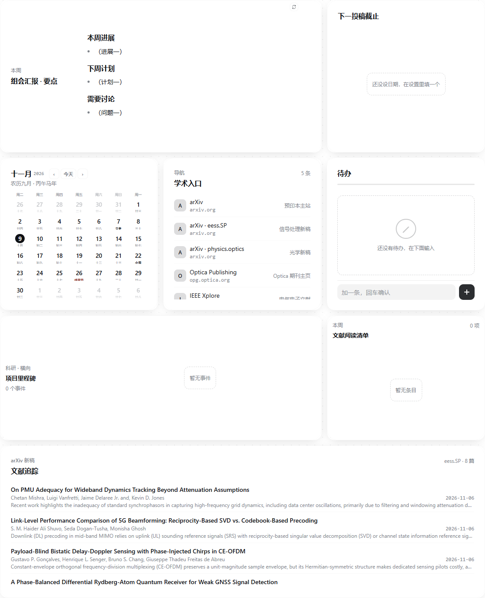
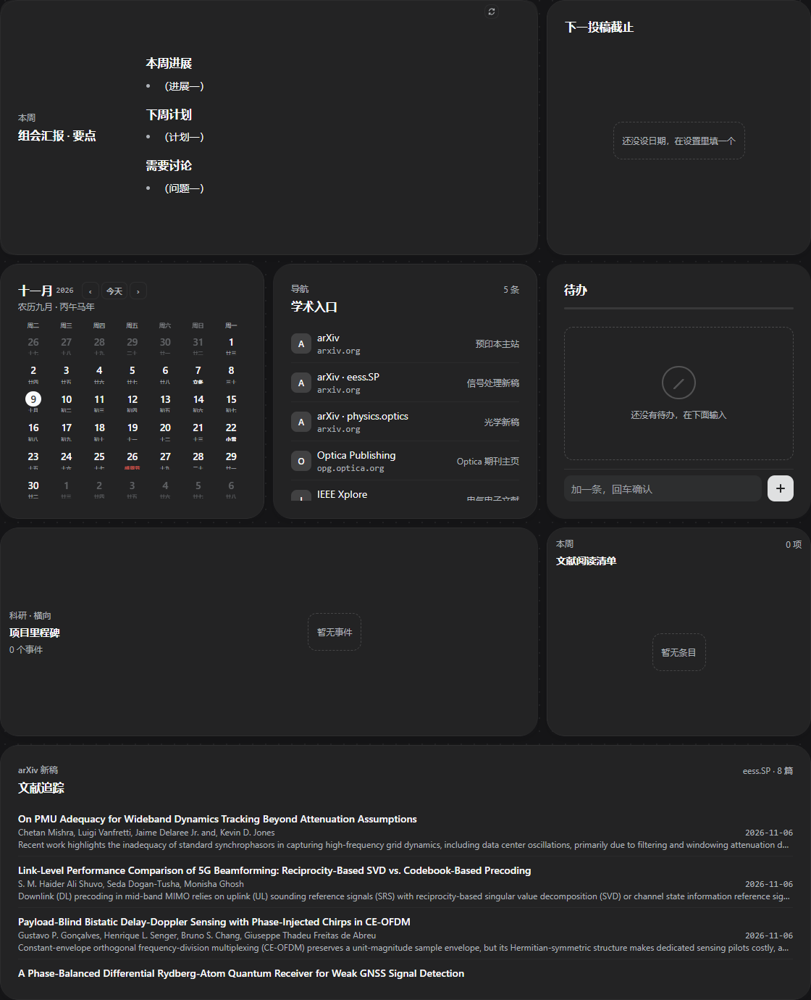
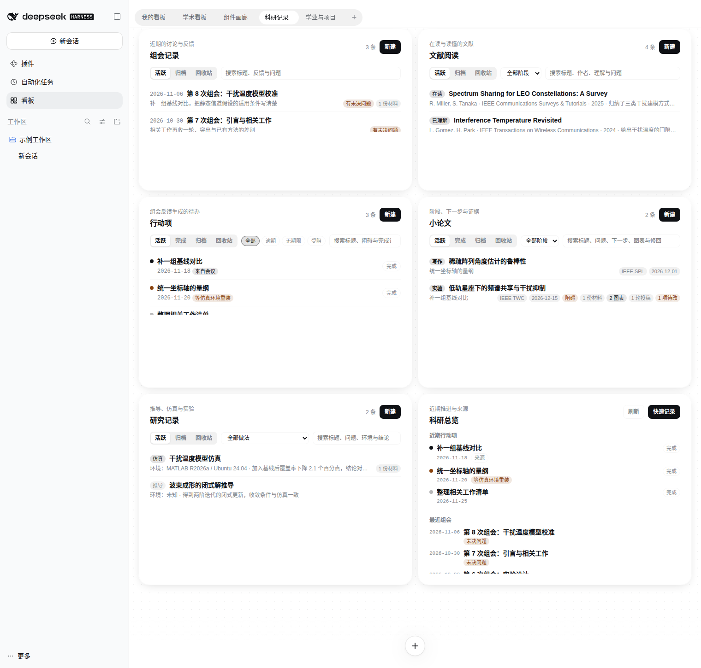
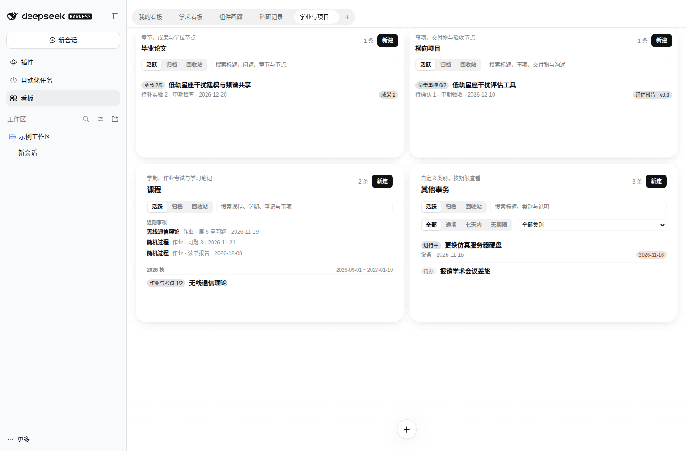

# dsh-scholar-board

[中文](README.md) · [Live demo](https://study0915.github.io/dsh-scholar-board/)

A scholar board plugin for DeepSeek Harness. A page of draggable, resizable widget cards, plus a set of research record cards for graduate students in communications: group meetings, action items, manuscripts, literature, research notes, the thesis, projects, courses and errands live on one page. Cards reference each other, and the host stores every record.

<p align="center">
  
  
</p>

## What it records

| Card | What it holds |
|---|---|
| Group meeting | Brief, discussion feedback, open questions and materials. Feedback creates an action item that keeps its source; a new meeting can be prepared from the last one; the outline copies as Markdown |
| Action items | Status, optional due date, blockers and completion note; filters for upcoming, overdue, no due date and blocked; completed items stay in history |
| Manuscript | Research question, stage and stage history, next step, blockers, target venue and submission date; a figure and table list, submission rounds and revision items trace feedback to the change and evidence |
| Literature | To read, reading and understood, with authors, venue, year, source link and your own understanding; a feed abstract never becomes your notes |
| Research notes | Derivation, simulation or experiment with the research question, environment, seeds, parameters and metrics with units, conclusion and result materials |
| Thesis | Chapter progress, result sources, experiments still to run and degree milestones; results keep only the source record id and a missing source is marked |
| Project | Requirement summary, your own tasks, deliverable versions, communication conclusions, acceptance milestones and open issues; the default template keeps no contract amounts, quotes or payment milestones |
| Course | Courses grouped by term with assignments, exams and study notes; a coming-up section lines up open dated work across courses |
| Other tasks | Errands outside courses and papers under custom categories, ordered by due date with filters for overdue, next seven days and no due date, archivable when done |
| Research overview | Recent action items, the latest meetings and active manuscripts on one page; complete an action item in place and expand its source meeting |

There is also a **paper feed** card: new arXiv submissions by category, one paper per row with title, authors, submission date and a one-line abstract. A row opens its abs page; Add to board turns it into a literature item to read.

## How records work

- The host stores records and shares them. One record can appear on several cards and views; removing a card keeps the record.
- Lists search and switch between active, archived and trash; trashed records are cleared after thirty days.
- Details edit in place and keep a draft while you type; a failed save keeps your input, and a revision conflict offers the latest record.
- Cross-card links keep forward references only, and a missing source is marked rather than filled in.
- Record backup in the settings page exports `.dshrecords`; importing previews the count, gives every record a new id, keeps references inside the package and leaves existing records untouched.

<p align="center">
  
  
</p>

## The board itself

- Several board tabs with free dragging, resizing and arranging. A fresh install lays out the Scholar board: a flip-group card for group-meeting briefs, a submission countdown, a calendar, academic links, to-dos, project milestones, a reading list, and a paper feed that follows an arXiv category.
- The widget library slides up from the bottom. Built-in widgets and the ones you write share one format: `widget.json`, `index.html`, `style.css`, plus `main.js` when a widget needs a script.
- Each widget runs in its own sandboxed iframe: strict CSP, no network or cookies, and a MessagePort bridge to the host. Permission is bound to the content hash, so changing one byte asks again.
- The source editor loads CodeMirror on demand and offers drafts and a real sandbox preview. Replacing every instance requires an explicit choice and a version check.
- The agent in a session can list widgets, write widgets, place cards and push data; `widget_show` draws one in the answer. Only `widget_catalog` is exposed by default, and the other tools appear when it names them in `expose`.
- Other plugins can register widgets, data sources, actions, host capabilities and markets.

Details: [writing a widget](docs/widgets.md) and [the provider API](docs/provider.md).

<p align="center">
  
</p>

## Install

Node 22 or newer and dsh 0.2.1-rc.1 or newer.

```sh
dsh plugin --profile web add github:Study0915/dsh-scholar-board
```

Replace `web` with the profile you boot. If pnpm blocks the dependency build script, approve the `allowBuilds` line it prints and retry. The repository carries no `lib/`, so installing from GitHub builds the package once at install time.

From a checkout:

```sh
npm install
npm run build
dsh plugin --profile web add .
```

## Development

```sh
npm install
npm run verify   # lint, ADR and CHANGELOG checks, types and build, unit tests, real-host smoke, size matrix
```

Product scope is in the [product plan (Chinese)](docs/scholar-product.md), tasks and acceptance in the [implementation plan (Chinese)](docs/PLAN-scholar.md), structure and cross-module invariants in [ARCHITECTURE.md](ARCHITECTURE.md).

## Status

S00–S08 are complete and the group meeting → action item → manuscript → research overview path is usable. Multi-user collaboration, cloud sync, a long-form editor and experiment execution are out of scope. The older campus card remains available with CSV/ICS import and export and in-board reminders.

## License and credits

MIT. This project is a derivative of [Nwflower/dsh-widget-board](https://github.com/Nwflower/dsh-widget-board) (MIT, Copyright (c) 2026 Nwflower), independently maintained by Study0915 and not affiliated with upstream; the fork point is upstream master plus the stacked changes of upstream PRs #11–#14 (snapshot of 2026-11-04). The original copyright and license notices for upstream and every third-party dependency are kept in [LICENSE](LICENSE) and [THIRD_PARTY.md](THIRD_PARTY.md); the `nwflower.*` example widgets and market prototypes were written by Nwflower and keep that attribution under MIT.
