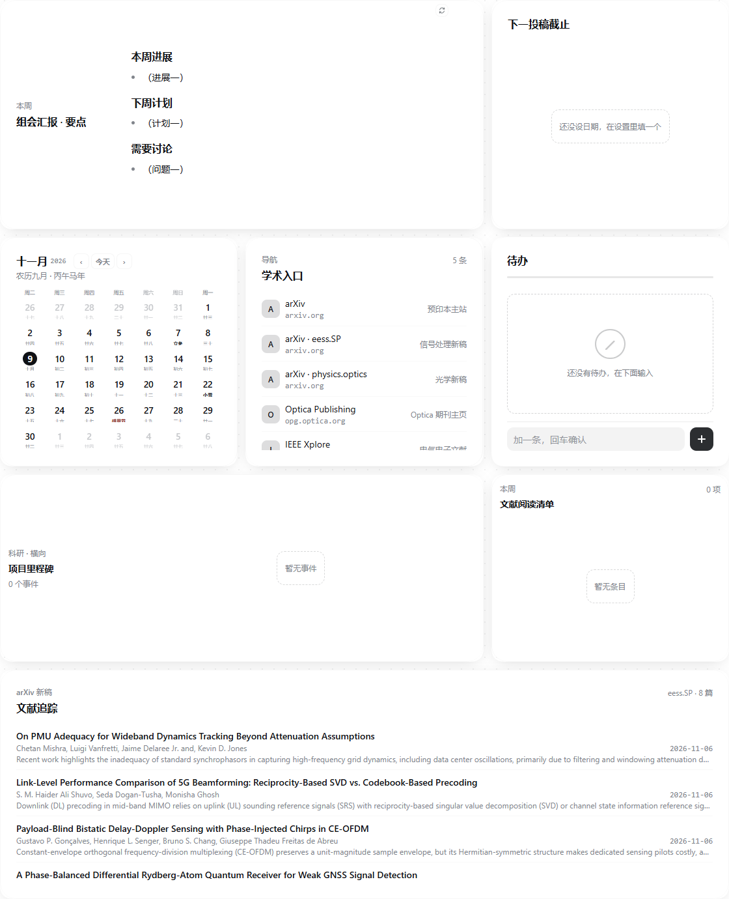
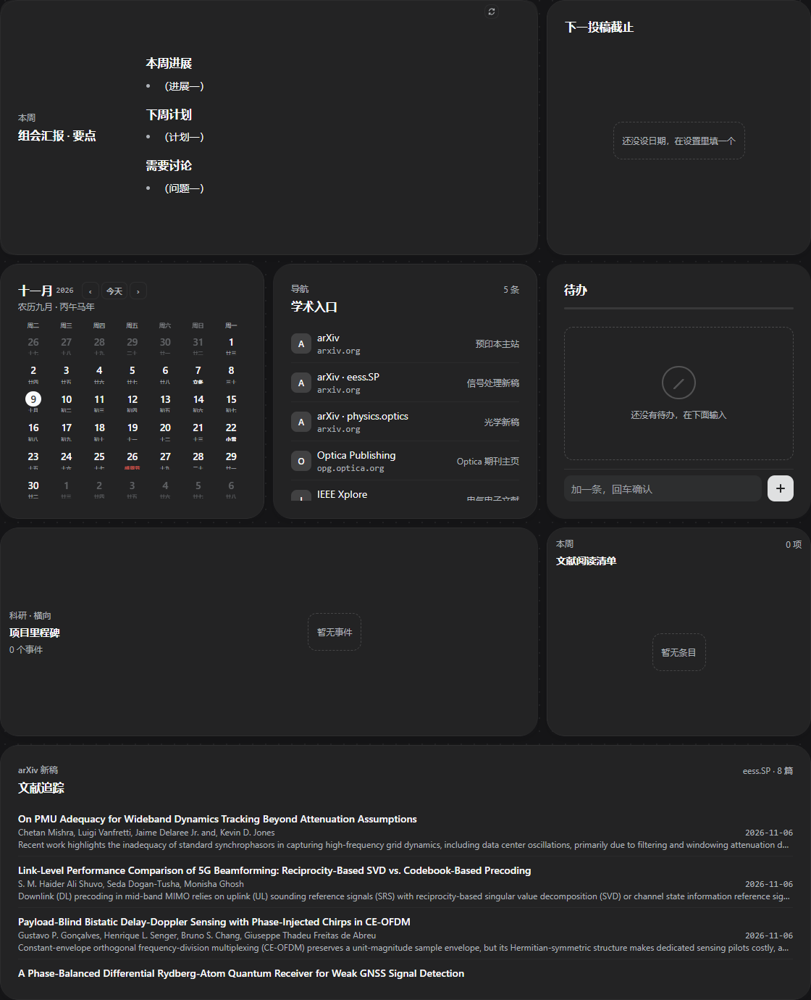
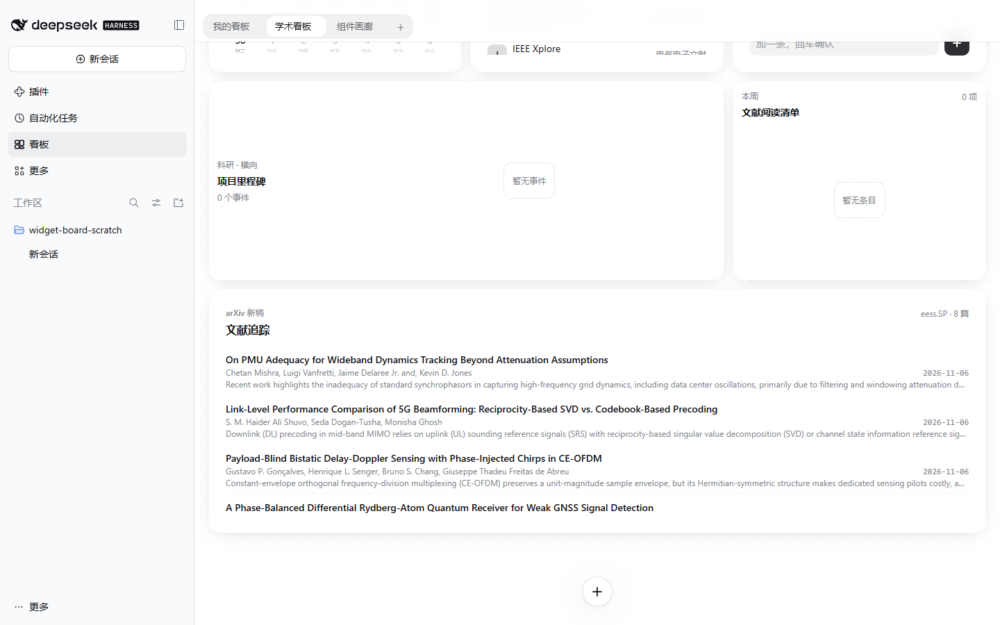

# dsh-scholar-board

[English](README.en.md)

> 本项目基于 [Nwflower/dsh-widget-board](https://github.com/Nwflower/dsh-widget-board)（MIT，Copyright (c) 2026 Nwflower）二次开发，由 Study0915 独立维护，与上游无从属关系。分叉点为上游 master 与上游 PR #11–#14 的叠加改动（2026-11-04 快照）；原项目的版权与许可声明完整保留在 [LICENSE](LICENSE)。

本地图片：在“创建卡片”中选择图片模板，上传不超过 10MiB 的静态 PNG/JPEG/WebP，填写 alt、说明与焦点。宿主会去除元数据并转换为受限 WebP；图片以实例媒体引用保存。组件声明 `widget-board:media.read` 后可用 `await widget.readMedia('background', { signal })` 取得 Blob，创建的对象 URL 由组件在暂停、替换和卸载时释放。

`.dshboard` 的 format2 使用 gzip 压缩 JSON，包含引用的图片、实例和组的标识及排列元数据。需要正文和状态时仍勾选“带上数据”。导入先校验全部资源，再创建完整看板；format1 仍可读取。`.dshw` 继续只导出组件源码和类型资源。媒体整理通过人工 `POST api/widget-board/media/collect` 清除超过 24 小时、没有实例或有效上传 ticket 引用的资源。

DeepSeek Harness 的学术看板：一页可以拖动、缩放的卡片，每张卡片是一个小组件。组件由你或会话里的 agent 写成三份文件，也可以由其他插件提供。项目面向通信方向硕博的个人科研与学习记录，延续原有卡片与动效风格。

当前提供学术看板组合、文献订阅与组会记录。组会记录卡是共享记录的第一批：列表可搜索、按活跃、归档与回收站切换，详情直接编辑并在输入时自动存草稿；保存失败保留输入，修订冲突可以载入最新记录。记录由宿主共享保存，移除卡片不删除记录，回收站里的记录三十天后自动清除。后续优先共享行动项和小论文进度，再扩展研究记录、毕业论文、横向项目、课程与其他事务；采用看板内短记录和外部正文材料结合的方式。后续能力尚未实现，详见 [产品规划](docs/scholar-product.md) 与 [实施计划](docs/PLAN-scholar.md)。通用布局、编辑与性能改进将独立整理为上游贡献候选。

**[上游演示](https://nwflower.github.io/dsh-widget-board/)** · [安装](#安装) · [写一个组件](#写一个组件) · [给插件提供方](#给插件提供方)

<p align="center">
  
  
</p>

<p align="center">
  
</p>

上面两张是第一次启动铺好的「学术看板」：组会汇报的翻面组卡、投稿倒数、日历、学术入口、待办、项目里程碑、文献阅读清单，以及最下面按 arXiv 分类订阅的文献追踪。第三张是文献追踪卡的样子——一行一篇，标题、作者、提交日期与一行摘要，点一行在新标签页打开 abs 页。

组会记录卡从组件库添加，不随默认看板铺设：标题、日期、汇报要点、讨论反馈、未决问题与材料链接；材料只收 http/https，随记录保存地址与说明，不复制文件。

组件画廊是第三块看板，每个内置组件各铺一张，按数据展示、工具与动效模板分组：

<p align="center">
  
  
</p>

<hr>

## 三份文件

`widget.json` 写名字与尺寸，加 `index.html`、`style.css`，需要脚本时加 `main.js`。内置组件、你自己写的、agent 生成的，都是这一种格式。写完文件，卡片出现在组件库里。

<hr>

## 一个沙箱

每次运行都在自己的沙箱 iframe 里：严格 CSP，没有网络与 cookie，与宿主只经 MessagePort 桥通信。授权绑在组件内容的哈希上，改一个字节就要重新点一次允许。

<hr>

## 几个入口

| 侧栏的「看板」 | 切换看板标签，拖动与整理卡片；第一次打开时已铺好默认看板 |
| 标签上的更多按钮 | 给这块看板改名或删掉它；右键标签是同一张菜单，不切换当前看板 |
|---|---|
| 加号菜单 | 添加、整理、刷新；添加打开从底部上拉的组件库面板 |
| 卡片齿轮 | 改组件的 props，填凭据，查看并授权数据源与权限 |
| 编辑组件源码 | 按需加载 CodeMirror；默认另存为用户组件，可应用到当前卡片；更新全部实例需要明确选择并核对版本 |
| 源码草稿与预览 | 保存、恢复和删除草稿；预览使用真实沙箱，动作、能力调用及通知不产生正式副作用 |
| 会话工具 | agent 列出组件、写组件、放卡、推数据；`widget_show` 在回答里当场画一张。默认只露出 `widget_catalog`，其余工具经它的 `expose` 点名后出现 |
| `widgetBoard` 服务 | 其他插件注册组件、数据源、动作、宿主能力与市场 |

<hr>

## 安装

```sh
dsh plugin add github:Study0915/dsh-scholar-board
```

pnpm 拦下依赖的构建脚本时，按它提示的 `allowBuilds` 允许后重试。仓库里不带 `lib/`，从 GitHub 安装时包会在安装时自己构建一次。

从本仓库开发：

```sh
npm install
npm run build
dsh plugin add <本仓库路径>
```

<hr>

## 写一个组件

在 `$DSH_HOME/widget-board/widgets/<id>/` 下建一个目录：

```text
widget.json     名字、尺寸、props、数据源、凭据
index.html      画面
style.css       样式，只用运行时套件的令牌
main.js         可选
samples.json    可选，每个尺寸族的样例
scripts         可选，按顺序排在 main.js 之前的额外脚本
vendor/         可选，随组件发布的第三方库（各自的许可照原样保留）
```

保存后宿主重读组件库，在线页面上的卡片换成新版本。

<hr>

### 盒子

看板给卡片定尺寸。运行时把内容盒归成两档：`data-box-width` 是 `narrow`、`regular`、`wide`，`data-box-height` 是 `short`、`regular`、`tall`，并给出 `--w-w`、`--w-h`、`--w-cols`。`defaultBox` 是加卡片时的默认盒子，`minBox` 是下限。

### 外观

间距与字号取 `--w-space-*`、`--w-type-*`；状态色取 `--w-tone-ok`、`--w-tone-warn`、`--w-tone-danger`、`--w-tone-idle`，配一行 `.w-sr` 读屏文字。布局原语是 `.w-frame`、`.w-actions`、`.w-scroll`，按档位隐藏用 `.w-hide-short`、`.w-hide-narrow`。

### 动效

翻面、磁吸、全息由运行时套件处理指针与键盘，组件只写画面。最外层加 `.t-flip-card` 与 `data-t-flip`，里面放 `.t-flip-card__inner`，两面各一个 `.t-flip-card__face`，背面再加 `.t-flip-card__back`；磁吸用 `.t-magnetic` 与 `data-t-magnetic`，全息用 `.t-holo` 与 `data-t-holo`。`flip-card`、`magnetic-card`、`holographic-card` 三个内置组件是可复制的示例。

### 数据与调用

`source` 写 `提供方:名字` 时点名插件注册的数据源；数据源声明了 `subscribe` 的，卡片可见时由它持续推数据，其余按 manifest 的 `refresh` 取。要按需再读一个源，把它写进 `sources`，用能力 `widget-board:data.read` 读，读回来的数据不改写卡片。`credentials` 让设置弹窗出现密钥输入框，值由宿主的凭据服务保存，组件读不到。在 manifest 里声明能力后经 `widget.call(id, args)` 调用，参数与结果按 JSON Schema 校验；参数可以整个省略，不声明参数的能力不传也行。握手时还带来 `widget.capabilityMetadata`：每一项能力的标题、说明、参数与结果 schema、权限，以及现在可不可用。内置组件「今日宜休」就是这么拿到的账号：「凭据」里填一个 `GITHUB_TOKEN`，卡上列出自己维护的仓库里还开着的 issue，用户名不用另填；点一行就在新标签页里打开那一条。

要网上的数据就写 `source: "http"` 并在 `request` 里给出地址；地址里的 `{名字}` 在每次读取时换成卡片 props 或 props schema 的默认值，主机必须列进 `permissions.hosts`。返回的 JSON 原样交给卡片。`request.format` 写 `"atom"` 时改读 Atom 接口：宿主把 XML 解析成对象，属性带 `@_` 前缀，`entry`、`author`、`link` 与 `category` 一律是数组；根元素必须是 Atom 命名空间下的 `feed`，带 `DOCTYPE` 的文档拒绝，不写 `format` 时按 JSON 读。内置的「文献追踪」卡按这个方式订阅 arXiv 分类：分类与条数在卡片设置里填，一行一篇，点一行打开 abs 页。

内置的「最近 Token 用量」卡绑定插件注册的 `widget-board:session.usage` 数据源：卡片可见时它先推一份当下的快照，之后每来一条带用量的会话事件再推一份，另有一条 10 秒的节奏；卡片离开视口就停，卡片自己也不计时。改它的 `scope` 会按新窗口退订重订。「今天」与「全部」把 dsh-usage 记下的历史用量与本插件启动之后的事件合在一起，标题旁标出「历史 dsh-usage」；dsh-usage 没装或读不出来时保留实时读数与空态，标成「历史未接入」或「历史不可用」，不拿零值冒充历史。「所选会话」不合并历史，标成「仅实时」。历史只给今天与全部的合计和四项分项，最近一次调用与走势始终来自实时事件：这段时间只有历史用量时，卡片照旧显示总量与分项，不显示最近一次调用。

组件自己不能导航，也不弹窗。要把链接开出去，用 `widget.open(url)` 交给包着它的页面，写在点击处理里；地址限 `http` 与 `https`。

<hr>

## 给插件提供方

宿主半边与浏览器半边各发布一个 cordis 服务 `widgetBoard`。两侧都报版本与功能清单：`service.apiVersion` 是主版本，`service.supportedApiVersions` 是旧入口接受的版本（2 与 3），`service.features` 与 `service.supports(name)` 说明这一侧现在有没有某一项。

新写的提供方走 `registerProvider({ apiVersion: 3, provider, features })`，拿回一个把手，组件目录、数据源、动作、能力与市场都经它挂上：

| 宿主侧把手 | 做什么 |
|---|---|
| `registerWidgets({ directory })` | 挂一个组件目录，读一次 |
| `registerDataSource()` | 挂数据源，卡片绑定后取数据 |
| `registerAction()` | 挂动作 |
| `registerCapability()` | 挂宿主能力，组件经 `widget.call` 调用 |
| `registerMarketProvider()` | 挂一个市场，交出条目与取包函数 |
| `dispose()` | 把这个提供方留下的全部注册一次撤下 |

浏览器侧的把手上是 `registerNativeWidget({ id, component })`，登记一个与组件库同 id 的 React 组件，对上之后由它渲染。子注册不写版本与提供方名，由把手注入。

既有提供方继续用 `registerWidgetType`、`registerDataSource`、`registerAction`、`registerCapability`、`registerMarketProvider`，注册时带版本 2 或 3 都行。同一侧同一个提供方包名只有一个活动把手，新旧入口不能混用；`dispose` 之后可以重新注册。

`features` 是用途声明，不改变这一侧提供什么：`capabilityMetadata`、`eventData`、`marketProvider`、`pushData` 四项按侧给出，缺的项按项降级。

新把手挂的组件目录、市场组件与原生组件的 id 必须写成 `<作者域>.<名字>`；本地组件与旧入口继续用扁平 id，已经装好的组件不改名。

一次读取、一次动作与一次能力调用最多等 15 秒（能力可以声明 1 到 25 秒），每个提供方同时 8 个调用，占满时立即返回错误而不排队。宿主按提供方记录注册数、失败、超时与现在是否可用，设置页的看板那一节列出这张表；卡片照自己的故障显示原因。

提供方跨包时取类型：

```ts
import type { WidgetBoardClientService } from 'dsh-scholar-board/service'
```

`dsh-scholar-board/provider` 是纯值 SDK，构造并校验注册要用的入参对象。运行时不值导入本插件、不加 `dsh.client.external`。插件停用或卸载时，它注册的组件、数据源、动作、能力、市场与授权一起撤下，已放着的卡片保留并显示不可用；装回来就恢复。

完整规则见 [docs/provider.md](docs/provider.md)。

<hr>

## 状态

校园卡支持看板内提醒：新卡默认提前24小时与到期提醒，可选择仅到期或提前1/72小时，也可关闭。全天事项在事项时区09:00提醒。只在看板打开、卡片运行时每分钟检查；离屏暂停、恢复补查，退出DSH后停止。先保存去重记录再合并通知；保存失败会提示并停止该轮通知。多窗口可能分别提醒。

校园卡的管理界面支持 CSV/ICS 导入导出。展开“CSV / ICS 文件交换”，选择 UTF-8 文件并确认字段映射、目标时区和重复项处理，再确认一次导入。支持逐行修正或跳过；单文件最多2MiB、10000个候选，单卡最多100项和64KiB状态。导出可筛选事项类型及完成状态，CSV标准模板仅含演示数据；完整备份使用看板包。

开发中。学术工作台的第一批功能里，文献追踪卡与预置学术看板已经可用（新装时文献追踪铺在「学术看板」第四行）；仿真工作台在做，右侧栏、组件库页面、组件的版本历史与分享、导入还在做。

## 许可与致谢

MIT。上游项目与全部第三方依赖的版权、许可声明见 [LICENSE](LICENSE) 与 [THIRD_PARTY.md](THIRD_PARTY.md)；内置示例组件与市场原型中的 `nwflower.*` 组件由 Nwflower 编写，按 MIT 保留署名。
